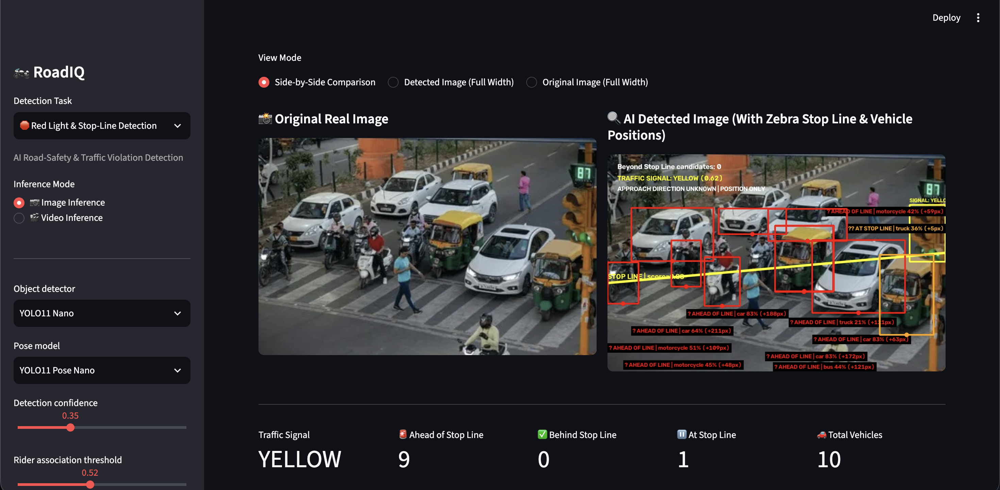
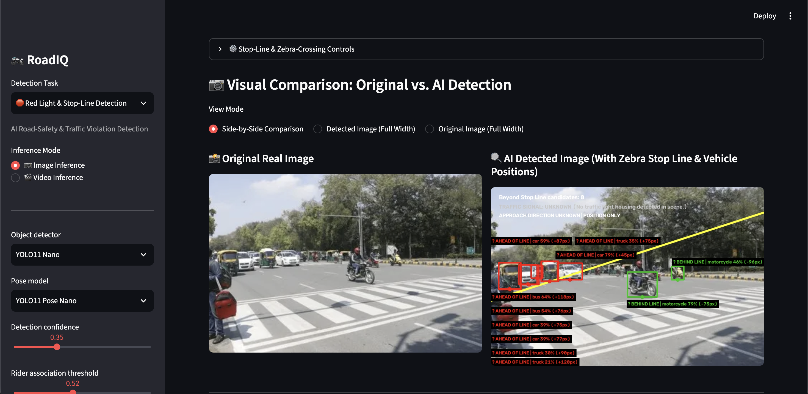
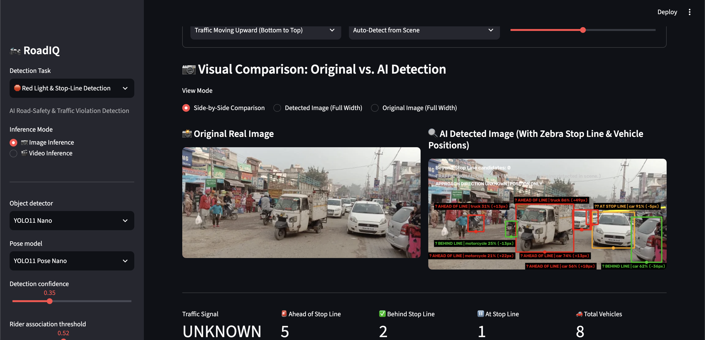
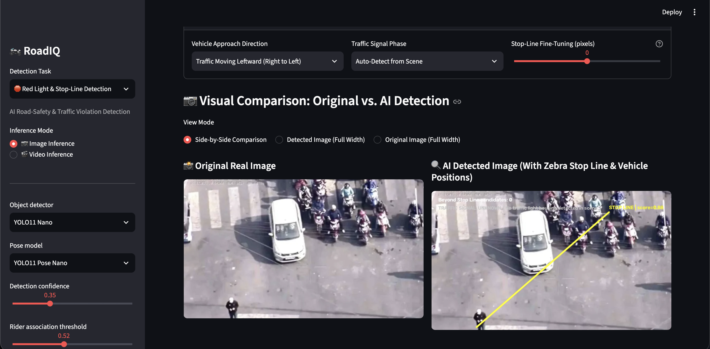
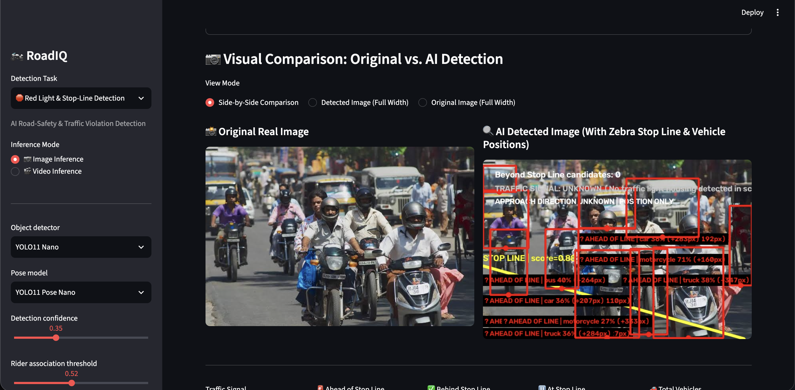
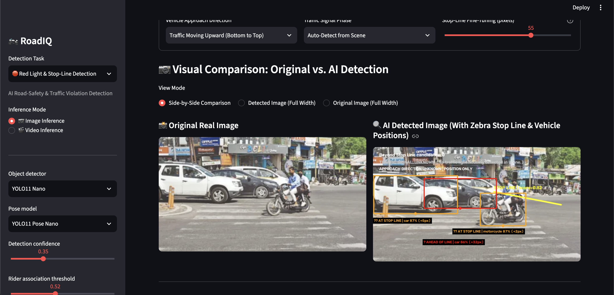
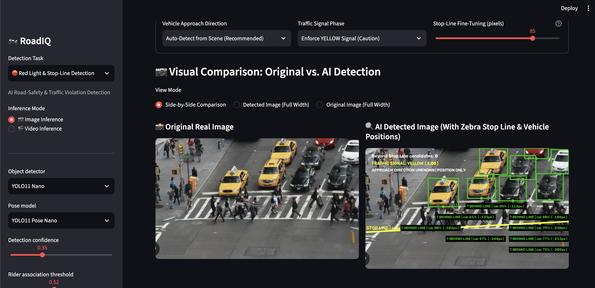
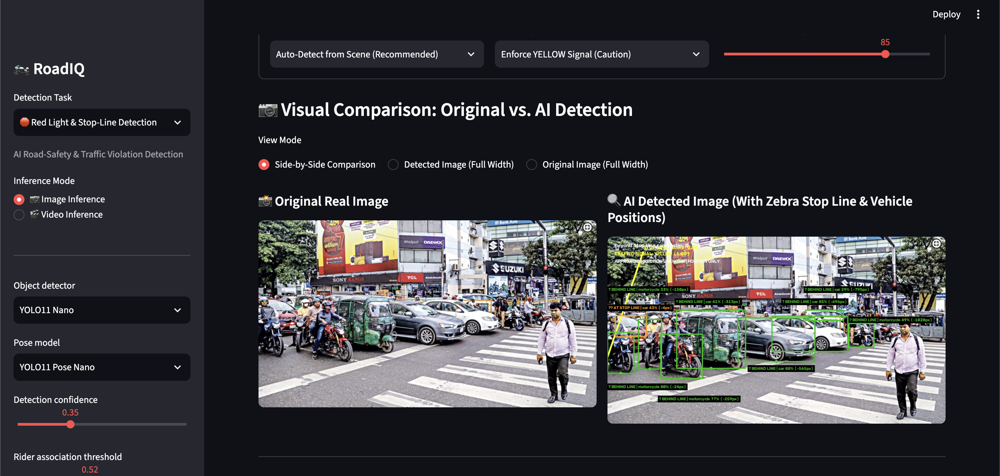
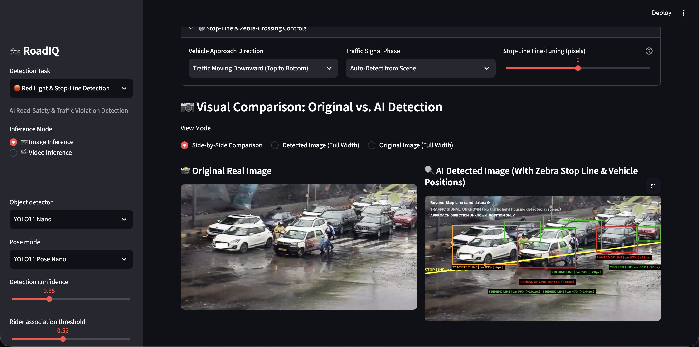

# RoadIQ — Red Light & Stop-Line Detection: Status & Test Log

Status snapshot of the red-light and stop-line detection pipeline (Detection Task: `Red Light & Stop-Line Detection`, Inference Mode: `Image Inference`), current as of this test batch.

**Config used for all tests below:** Detector `YOLO11 Nano`, Pose `YOLO11 Pose Nano`, Detection confidence `0.35`, Rider association threshold `0.52`. The Stop-Line & Zebra-Crossing Controls (Vehicle Approach Direction, Traffic Signal Phase, Stop-Line Fine-Tuning) varied between tests and are listed in each entry where they were visible in the screenshot.

---

## Summary

| # | Scene | Signal shown | Stop line | Vehicles labeled | Verdict |
|---|---|---|---|---|---|
| 1 | Junction queue, signal head in frame | YELLOW (0.62) | Diagonal through the vehicle cluster | 10 (9 ahead, 0 behind, 1 at line) | Unverified; direction unknown, 9 of 10 ahead; auto-rickshaws labeled truck/bus |
| 2 | Wide road, zebra at bottom right, sparse traffic | UNKNOWN | Steep diagonal, exits the road at the right | 11 (9 ahead, 2 behind) | Stop line misfit |
| 3 | Market street, no zebra or stop line visible | UNKNOWN | Only a sliver at the right edge | 8 (5 ahead, 2 behind, 1 at line) | False stop-line fit; classifications not meaningful |
| 4 | Overhead view, zebra crossing and scooter queue | UNKNOWN | Diagonal across the vehicle cluster | 0 | Missed all vehicles |
| 5 | Dense motorcycle crowd, no stop line visible | UNKNOWN | Diagonal across the bottom, score 0.88 | 7+ (all legible ones ahead) | Spurious line, labels garbled |
| 6 | Intersection, SUV and scooter on zebra | UNKNOWN | Short line through the riders' upper bodies | 3 (1 ahead, 2 at line) | Line misplaced |
| 7 | Crosswalk with taxis queued | YELLOW (1.00, enforced) | Near-horizontal at the near edge of the zebra | 8 (all behind) | Plausible; signal confidence misleading |
| 8 | Dhaka street traffic, zebra at bottom | YELLOW (1.00, enforced) | Near-vertical at the far-left edge | 9 (8 behind, 1 at line) | Stop line misfit; extreme pixel offsets |
| 9 | Rainy junction queue | UNKNOWN | Near-horizontal through the front bumpers | 7 (2 ahead, 4 behind, 1 at line) | Plausible; best result of the batch |

Summary counters (`Ahead of Stop Line`, `Behind Stop Line`, `At Stop Line`, `Total Vehicles`) were visible in the screenshots for tests 1 and 3 only; for the other frames the counts above are tallied from the on-image labels.

Only tests 7 and 9 have a stop line that plausibly matches the scene. In the other 7 frames the line is misplaced, spurious, or fitted to a scene with no visible stop line, so the ahead/behind classification there is not reliable. `Beyond Stop Line candidates` is `0` on all 9 frames and no frame produced a RED signal, so the red-light violation path was not exercised in this batch.

---

## Recurring issues

1. **Stop-line fit is unreliable.** Frames 2, 3, 4, 5, 6, 8 show a line that does not follow the zebra crossing or stop line in the image: a steep diagonal leaving the road (2), a line in a scene with no stop line or zebra (3, 5), a diagonal through the vehicle cluster (4), a short line through the riders (6), and a near-vertical line at the frame edge (8). Frame 1 also shows a diagonal through the queue and needs a manual check. The fit still reports a high score (`score=0.88` in tests 4 and 5) even where no stop line is visible. When no stop line is found, the pipeline should report none instead of falling back to a fitted line.
2. **Approach direction banner always reads `APPROACH DIRECTION UNKNOWN | POSITION ONLY`**, including when a direction was selected manually (tests 3: Upward, 6: Upward, 9: Downward). In test 4 (Leftward) the banner line is missing. This suggests the manual direction is not reaching the ahead/behind classification, which then runs on position only.
3. **Signal is rarely detected, and no RED case was exercised.** Six of 9 frames report `TRAFFIC SIGNAL: UNKNOWN (No traffic light housing detected in scene.)`. Test 1 reads `YELLOW (0.62)` from the scene. Tests 7 and 8 read `YELLOW (1.00)` only because `Enforce YELLOW Signal (Caution)` was selected; the `1.00` looks like a detection confidence but is an override value. `Beyond Stop Line candidates` is `0` everywhere, including test 1 where 9 vehicles are labeled `AHEAD OF LINE` under a detected YELLOW signal.
4. **Vehicle class errors on three-wheelers and jeeps.** Auto-rickshaws and similar vehicles are labeled `truck` or `bus` at low confidence (frame 1: `truck 21%`, `bus 44%`, `truck 36%`; frame 2: `bus 64%`, `bus 54%`, `truck 30%`; frame 5: `bus 40%`, `truck 38%`).
5. **Missed or partial vehicle detection.** Frame 4 (overhead view) has zero vehicle boxes despite a car and a queue of scooters. Dense frames (1, 9) appear to be only partly covered.
6. **Overlapping, low-contrast, and clipped on-image text.** The signal and banner lines are hard to read on busy backgrounds (2, 3, 5, 8). The `STOP LINE | score` label is hidden behind vehicle labels or boxes (1, 7, 8, 9). In frame 5 vehicle labels stack on top of each other, leaving fragments such as `192px)`, `110px)`, `7px)`, and `AHE? AHEAD OF LINE`. Frame 1 clips `SIGNAL: YELLOW` at the right edge. Cosmetic, but makes manual QA harder.
7. **Extreme pixel offsets from a misplaced line.** Frame 8 reports offsets of `-1020px`, `-795px`, `-696px`, and frame 5 reports `+283px` to `+353px`, which are distances to a line that is not at the real stop position.

---

## Per-image detail

### Test 1

Junction queue with auto-rickshaws, cars, and motorcycles facing the camera, a signal head at the right, and a zebra crossing with pedestrians in the foreground. Detected `TRAFFIC SIGNAL: YELLOW (0.62)` and `APPROACH DIRECTION UNKNOWN | POSITION ONLY`. Counters: `Ahead of Stop Line 9, Behind Stop Line 0, At Stop Line 1, Total Vehicles 10`. The yellow stop line runs diagonally through the vehicle cluster, and with the direction unknown, 9 of 10 vehicles are labeled `AHEAD OF LINE` (offsets `+48px` to `+211px`) with one `?? AT STOP LINE | truck 36% (+5px)`. The ahead/behind result and the signal reading need a manual check. Auto-rickshaws are labeled `truck` and `bus` at 21–44%. The `SIGNAL: YELLOW` label is clipped at the right edge and the `STOP LINE | score` label is hidden by vehicle boxes.

### Test 2

Wide road with trees, a zebra crossing at the bottom right, a motorcycle crossing in the middle distance, and a cluster of auto-rickshaws and cars at the left. Detected `TRAFFIC SIGNAL: UNKNOWN (No traffic light housing detected in scene.)`. The Stop-Line & Zebra-Crossing Controls panel is collapsed, so the settings are not visible. The yellow stop line slopes steeply upward and leaves the road into the tree area at the right edge instead of following the zebra crossing. Nine vehicles are labeled `AHEAD OF LINE` (`car 59%`, `truck 35%`, `car 79%`, `bus 64%`, `bus 54%`, `car 39%` ×2, `truck 30%`, `truck 21%`) and two motorcycles `BEHIND LINE` (`-75px`, `-96px`). Because the line is misplaced, these classifications are not reliable. Auto-rickshaws are labeled `bus` and `truck`. The signal line text is faint against the background.

### Test 3

Crowded market street with a cargo three-wheeler in the center, a white hatchback at the right, and pedestrians at the left. There is no visible zebra crossing, stop line, or signal. Settings: `Traffic Moving Upward (Bottom to Top)`, `Auto-Detect from Scene`. Detected `TRAFFIC SIGNAL: UNKNOWN`, with the banner still reading `APPROACH DIRECTION UNKNOWN | POSITION ONLY`. Counters: `Ahead of Stop Line 5, Behind Stop Line 2, At Stop Line 1, Total Vehicles 8`. Only a small yellow segment of the stop line is visible at the right edge, so the pipeline fitted a line where none exists and classified every vehicle against it (`truck 86% (+49px)`, `car 91% (-5px)` at line, `motorcycle 25% (-13px)` behind, and others). Two motorcycle labels are at only 21–25% confidence. Banner text is mostly unreadable against the busy background.

### Test 4

Overhead view of an intersection with a zebra crossing, a white car, and a queue of scooters at the right. Settings: `Traffic Moving Leftward (Right to Left)`, `Auto-Detect from Scene`, Stop-Line Fine-Tuning `0`. Detected `TRAFFIC SIGNAL: UNKNOWN (No traffic light housing detected in scene.)` and `STOP LINE | score=0.88`. No vehicle boxes or labels are drawn at all, so the car and about ten scooters are all missed; the summary counters are not visible in the screenshot. The yellow line is a steep diagonal across the vehicle cluster, and the `STOP LINE` label overlaps the scooters at the top right. The approach direction banner line is missing from the overlay.

### Test 5

Close view of a dense crowd of helmeted motorcyclists with jeeps and rickshaws behind. There is no visible stop line or zebra crossing. Detected `TRAFFIC SIGNAL: UNKNOWN (No traffic light housing detected in sc...)` and `APPROACH DIRECTION UNKNOWN | POSITION ONLY`; both header lines are oversized and clipped at the right edge. `STOP LINE | score=0.88` is drawn as a diagonal across the lower part of the frame, so the line is spurious. Every legible label is `AHEAD OF LINE` with large offsets (`car 36% (+283px)`, `motorcycle 71% (+160px)`, `bus 40%`, `car 36% (+207px)`, `truck 38% (+347px)`, `motorcycle 27% (+353px)`, `truck 36% (+284px)`). Labels stack on top of each other, leaving fragments such as `192px)`, `110px)`, `7px)`, and `AHE? AHEAD OF LINE`. Summary counters are not visible in the screenshot.

### Test 6

Intersection with a white SUV and a dark sedan queued at the left and a scooter rider crossing the zebra at the right. Settings: `Traffic Moving Upward (Bottom to Top)`, `Auto-Detect from Scene`, Stop-Line Fine-Tuning `55`. Detected `TRAFFIC SIGNAL: UNKNOWN` and `STOP LINE | score=0.82`, with the banner reading `APPROACH DIRECTION UNKNOWN | POSITION ONLY` despite the manual direction. The yellow line is a short segment that passes through the scooter rider's upper body and sits well above the zebra crossing. Labels: `?? AT STOP LINE | car 87% (+5px)`, `?? AT STOP LINE | motorcycle 87% (+2px)`, `? AHEAD OF LINE | car 86% (+32px)`. The line placement makes these classifications unreliable. Summary counters are not visible in the screenshot.

### Test 7

Crosswalk with pedestrians crossing and a queue of yellow taxis and dark cars beyond it. Settings: `Auto-Detect from Scene (Recommended)`, `Enforce YELLOW Signal (Caution)`, Stop-Line Fine-Tuning `85`. Detected `TRAFFIC SIGNAL: YELLOW (1.00)`, which is the enforced value rather than a detection, and `APPROACH DIRECTION UNKNOWN | POSITION ONLY`. The yellow stop line is near-horizontal and appears to sit at the near (camera-side) edge of the zebra crossing. All 8 labeled cars are `BEHIND LINE` (`car 85% (-113px)`, `81% (-133px)`, `80% (-108px)`, `80% (-103px)`, `79% (-230px)`, `47% (-244px)`, `77% (-213px)`, `75% (-309px)`). The result is plausible, but the offsets may be overstated if the line should sit at the far edge of the zebra. The `STOP LINE | score` label is hidden behind a vehicle label. Summary counters are not visible in the screenshot.

### Test 8

Dense Dhaka street scene with auto-rickshaws, cars, and motorcycles, and a pedestrian walking across a zebra crossing at the right. Settings: `Auto-Detect from Scene (Recommended)`, `Enforce YELLOW Signal (Caution)`, Stop-Line Fine-Tuning `85`. Detected `TRAFFIC SIGNAL: YELLOW (1.00)` (enforced) with `APPROACH DIRECTION UNKNOWN | POSITION ONLY`; the signal line and `STOP LINE | score` text overlap and are garbled. The stop line is a steep, near-vertical segment at the far-left edge of the frame instead of running along the zebra crossing. As a result 8 vehicles are `BEHIND LINE` with extreme offsets (`motorcycle 49% (-1020px)`, `car 29% (-795px)`, `car 85% (-696px)`, `car 88% (-565px)`) and one is `?? AT STOP LINE | car 43% (-4px)`. The classifications are not meaningful. Summary counters are not visible in the screenshot.

### Test 9

Rainy junction with a queue of cars facing the camera and people with umbrellas near the front row. Settings: `Traffic Moving Downward (Top to Bottom)`, `Auto-Detect from Scene`, Stop-Line Fine-Tuning `0`. Detected `TRAFFIC SIGNAL: UNKNOWN (No traffic light housing detected in scene.)`, with the banner still reading `APPROACH DIRECTION UNKNOWN | POSITION ONLY`. The yellow stop line is near-horizontal and runs through the front bumpers of the queued cars. Labels: `?? AT STOP LINE | car 89% (-6px)`, `? AHEAD OF LINE | car 87% (+21px)`, `? AHEAD OF LINE | car 66% (+56px)`, and four `BEHIND LINE` cars (`74% (-20px)`, `83% (-16px)`, `59% (-101px)`, `47% (-144px)`). This is the most coherent result of the batch, but it still needs a manual check, and cars further back in the queue appear only partly covered. Summary counters are not visible in the screenshot.

---

## Open items

- Add a validity check on the stop-line fit so that scenes with no visible stop line or zebra crossing (tests 3, 5) return no stop line instead of a fitted one, and review the line placement on tests 2, 4, 6, 8.
- Investigate why the manual approach direction is not reflected in the banner or the classification (tests 3, 6, 9); confirm the selected direction reaches the ahead/behind step.
- Add a test frame with a visible RED signal and a vehicle past the line to exercise `Beyond Stop Line candidates`, which is `0` on all 9 frames.
- Confirm whether a detected YELLOW signal should ever produce violation candidates (test 1: YELLOW with 9 vehicles ahead, 0 candidates).
- Show enforced signal phases as `ENFORCED` instead of a `1.00` confidence value (tests 7, 8).
- Check detection of overhead views (test 4, zero vehicles) and review the `truck`/`bus` labels on auto-rickshaws and jeeps (tests 1, 2, 5).
- Check where the stop line should sit relative to the zebra crossing for the selected direction (test 7).
- Fix overlapping, clipped, and hidden on-image text, and add de-overlapping for labels (tests 1, 2, 3, 5, 7, 8).
- Capture the summary counters in future test screenshots (only tests 1 and 3 showed them).
